# LAPORAN PROYEK UJI KOMPETENSI SKEMA SERTIFIKASI PEMROGRAM
## Sistem Manajemen dan Penyewaan Garasi Terpadu (GARASI TA / GARTA TAKALAR)

- **Nama Peserta (Asesi):** Muh. Ryan Ardiansyah
- **Skema Sertifikasi:** Okupasi Pemrogram
- **Nomor Skema:** IMT.01.15/SSK/LSP/IX/2021
- **Nama Asesor:** Citra Lestari
- **Tanggal Pelaksanaan:** 22 November 2026
- **Jenis & Tipe Aplikasi:** Aplikasi Web Full-Stack dengan Basis Data Relasional Terstruktur (SQLite ACID / SvelteKit 5 / Node.js 22 & Bun)
- **Tautan Repositori GitHub:** [https://github.com/mzkyann/Project_Garasi_LSP_Muh_Ryan_Ardiansyah](https://github.com/mzkyann/Project_Garasi_LSP_Muh_Ryan_Ardiansyah)

---

## 1. Ringkasan Sistem dan Spesifikasi Kebutuhan

### 1.1 Deskripsi Umum Sistem
**GARASI TA (GARTA — Garasi Takalar)** adalah sistem aplikasi berbasis web terintegrasi yang dirancang untuk mengelola operasional unit garasi kendaraan dan transaksi penyewaan secara aman, transparan, dan terstruktur di Kabupaten Takalar. Sistem ini mengakomodasi berbagai jenis kendaraan, mulai dari kendaraan roda dua (sepeda manual dan sepeda motor), mobil konvensional (bensin/diesel), hingga kendaraan masa depan yaitu mobil listrik (*Electric Vehicle* / EV) yang terintegrasi dengan stasiun pengisian daya (*Wallbox SPKLU 22 kW*). Sistem memisahkan hak akses dan wewenang pengguna secara tegas berbasis peran (*Role-Based Access Control* / RBAC), yaitu peran **Administrator** dan **Penyewa**.

Aplikasi dibangun untuk memenuhi seluruh 8 Unit Standar Kompetensi Kerja Nasional Indonesia (SKKNI) pada skema Okupasi Pemrogram:
1. **J.620100.009.02 (Menggunakan Spesifikasi Program):** Menerjemahkan seluruh aturan bisnis penitipan garasi, formula tarif harian/bulanan (flat 25x), formula pengisian daya baterai mobil listrik (100% full capacity kWh), pembatasan kuota dan penomoran batch otomatis, deteksi bentrok tanggal (*collision-free*), hingga perpanjangan masa sewa aktif.
2. **J.620100.016.01 (Menulis Kode dengan Prinsip Guidelines & Best Practices):** Menerapkan arsitektur *Clean Code*, penamaan kode representatif dalam Bahasa Indonesia dan Inggris yang konsisten, penanganan error validasi sisi server, serta pemisahan logika bisnis dari antarmuka.
3. **J.620100.017.02 (Pemrograman Terstruktur):** Struktur kode modular dan fungsional pada kalkulasi sewa, validasi format NIK 16 digit, filter tanggal reservasi non-bentrok, dan alur perpanjangan kontrak sewa.
4. **J.620100.018.02 (Pemrograman Berorientasi Objek / OOP):** Mengimplementasikan prinsip Abstraksi, Pewarisan (*Inheritance*), Enkapsulasi, dan Polimorfisme pada hierarki kelas `Vehicle` (`Bicycle`, `Motorcycle`, `GasolineCar`, `ElectricCar`) dan `Garage` (`BicycleGarage`, `CarGarage`, `ElectricCarGarage`).
5. **J.620100.019.02 (Menggunakan Library / Komponen Pre-Existing):** Memanfaatkan framework modern SvelteKit 5, Svelte Core Runes, TypeScript 5.9, Tailwind CSS v4, Lucide Icons, dan Vitest Runner.
6. **J.620100.021.02 (Menerapkan Akses Basis Data Relasional):** Penggunaan basis data relasional SQLite ACID terstruktur (`node:sqlite`) yang menjamin integritas referensial data melalui *Primary Key*, *Unique Constraints*, dan *Foreign Keys* (`CASCADE` dan `RESTRICT`).
7. **J.620100.025.02 (Melakukan Debugging):** Penanganan validasi formulir sisi server yang aman, proteksi collision jadwal booking, dan pencegahan duplikasi data email maupun NIK.
8. **J.62010.033.02 (Melaksanakan Pengujian Unit Program):** Pengujian unit otomatis berbasis Vitest menggunakan teknik *Black-box Testing* (*Boundary Value Analysis* dan *Equivalence Partitioning*) dengan hasil 100% Lulus (14 dari 14 skenario uji).

---

### 1.2 Kebutuhan Fungsional Sistem
1. **Autentikasi dan Pendaftaran Akun Calon Penyewa:**
   - Calon penyewa mendaftar akun baru dengan mengisi Nomor Induk Kependudukan (NIK) tepat 16 digit angka numerik, nama lengkap, nomor telepon (10–15 digit), email unik (sebagai username akun), dan kata sandi minimal 6 karakter.
   - Status awal akun pendaftar baru adalah `PENDING` dan wajib diverifikasi oleh Administrator.
2. **Otorisasi dan Verifikasi Identitas oleh Administrator:**
   - Administrator memiliki otoritas penuh untuk memvalidasi identitas calon penyewa berdasarkan NIK 16 digit pada panel verifikasi KTP, dengan opsi menyetujui (`APPROVED`) atau menolak (`REJECTED`) pendaftaran.
   - Hanya penyewa berstatus `APPROVED` yang diizinkan melakukan transaksi sewa garasi.
3. **Manajemen Unit Garasi dan Pembuatan Massal (Batch Creation):**
   - Administrator dapat menambahkan unit garasi secara berkelompok (massal/batch) sebanyak 1 hingga 999 unit per kategori: Sepeda/Motor (kode `S001`–`S999`), Mobil Konvensional (kode `C001`–`C999`), dan Mobil Listrik EV (kode `E001`–`E999`).
   - Kode dibuat otomatis dan inkremental dengan penetapan tarif sewa harian dan tarif listrik per kWh (khusus garasi listrik).
4. **Formulir Transaksi Sewa Garasi Baru:**
   - Penyewa terverifikasi dapat memilih kategori kendaraan, mengisi nomor plat polisi (wajib kecuali sepeda gowes), merek kendaraan, serta kapasitas baterai listrik (kWh) untuk mobil listrik.
   - Durasi sewa dapat dipilih harian (maksimal 30 hari) atau bulanan (dihitung flat 25 kali tarif harian).
   - Sistem hanya menampilkan slot kosong yang kompatibel dan tidak mengalami bentrok jadwal (*collision-free*).
   - Khusus mobil listrik yang memilih garasi EV, biaya cas dihitung otomatis: $\text{Kapasitas Baterai (kWh)} \times \text{Tarif Listrik/kWh}$ (kewajiban pengisian penuh 100%). Penyewa mengunggah bukti transfer pelunasan.
5. **Pusat Persetujuan (ACC Transaksi Sewa) oleh Administrator:**
   - Administrator memeriksa transaksi sewa masuk beserta bukti bayar yang diunggah. Begitu disetujui (ACC), status transaksi menjadi aktif dan status fisik garasi otomatis berubah menjadi sedang terisi (*used*) pada hari aktif.
6. **Perpanjangan Masa Sewa Aktif oleh Administrator:**
   - Administrator dapat memantau seluruh transaksi sewa yang sedang aktif disewa hari ini.
   - Administrator dapat memilih unit garasi untuk diperpanjang masa sewanya, menentukan tanggal selesai baru, menghitung otomatis sisa tagihan hari tambahan, dan mengunggah bukti bayar perpanjangan.
7. **Laporan Persewaan dan Rekapitulasi Keuangan Admin:**
   - Sistem menyajikan rekapitulasi data pendapatan sewa pokok, biaya listrik SPKLU, akumulasi omzet total, dan daftar transaksi.
   - Laporan dapat difilter ke dalam 4 mode fleksibel: Per Bulan dalam Tahun Tertentu, Per Hari dalam Bulan Tertentu, Per Tipe Garasi, dan Per Penyewa, serta dilengkapi tombol Cetak / Ekspor PDF.
8. **Halaman Profil Pengguna dan Logout Aman:**
   - Pengguna dapat melihat ringkasan identitas terverifikasi (NIK KTP 16 digit, nomor telepon, status verifikasi APPROVED, dan jumlah unit sewa berjalan) serta tombol keluar (*logout*) aman dari sesi sistem.

---

## 2. Use Case Diagram Sistem GARASI TA

Diagram Use Case memetakan batasan sistem serta interaksi fungsional antara Aktor terhadap proses bisnis penyewaan dan administrasi garasi pada aplikasi GARTA Takalar.

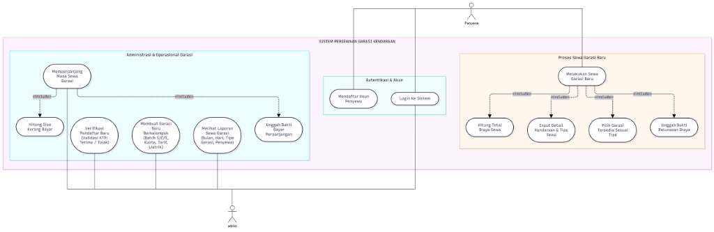  
*Gambar 1. Use Case Diagram Sistem GARASI TA (GARTA)*

### 2.1 Deskripsi Peran dan Alur Interaksi Aktor:
1. **Calon Penyewa (Pendaftar Baru):**
   - Melakukan pendaftaran akun menggunakan data resmi NIK 16 digit, nama lengkap, telepon, email, dan password.
   - Login ke sistem untuk memeriksa status verifikasi KTP (status awal `PENDING`). Sebelum diverifikasi, akses transaksi sewa diblokir.
2. **Penyewa (Terverifikasi / Approved):**
   - Mewarisi hak akses Calon Penyewa setelah akun disetujui (`APPROVED`) oleh Administrator.
   - Mengakses fitur **Melakukan Sewa Garasi Baru** yang meng-*include* 4 sub-proses:
     1. *Input Detail Kendaraan & Tipe Sewa* (harian/bulanan).
     2. *Pilih Garasi Tersedia Sesuai Tipe* (filter slot non-bentrok).
     3. *Hitung Total Biaya Sewa* (tarif sewa garasi ditambah biaya cas penuh baterai kWh khusus mobil listrik di garasi EV).
     4. *Unggah Bukti Pelunasan Biaya*.
   - Memantau riwayat kontrak sewa aktif dan yang telah selesai.
3. **Administrator (Admin):**
   - Memverifikasi Pendaftar Baru (validasi KTP 16 digit: Terima/Approve atau Tolak/Reject).
   - Membuat Garasi Baru Berkelompok (Batch S/C/E, kuota 1–999, tarif harian dan tarif listrik).
   - Memeriksa dan Menyetujui Pengajuan Sewa Baru (Pusat ACC Transaksi).
   - Memperpanjang Masa Sewa Garasi Aktif yang meng-*include* *Hitung Sisa Kurang Bayar* dan *Unggah Bukti Bayar Perpanjangan*.
   - Melihat dan Mencetak Laporan Sewa Garasi (filter bulan, hari, tipe garasi, penyewa).

---

## 3. Class Diagram Arsitektur Berorientasi Objek (OOP)

Dalam pemenuhan unit kompetensi **J.620100.018.02 (Pemrograman Berorientasi Objek)**, sistem GARASI TA dirancang menggunakan arsitektur modular 3 lapis: Lapisan Domain Kendaraan, Lapisan Domain Garasi, dan Lapisan Modul Transaksi Sewa & Services.

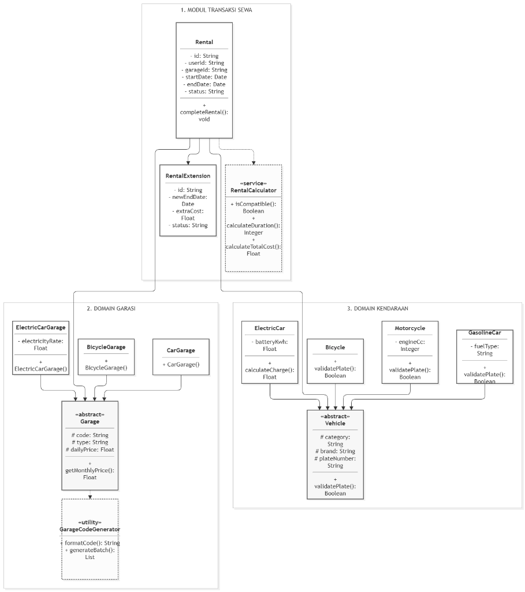  
*Gambar 2. Class Diagram Arsitektur Berorientasi Objek (OOP) Sistem GARASI TA*

### 3.1 Rincian Struktur Kelas dan Prinsip OOP:
1. **Hierarki Domain Kendaraan (`Vehicle` Hierarchy):**
   - **`Vehicle` (Abstract Base Class):** Mendefinisikan atribut terlindungi (`#category`, `#brand`, `#plateNumber`) dan metode polimorfik `validatePlate(): Boolean`.
   - **`Bicycle`:** Kelas konkret sepeda gowes/manual; nomor plat opsional/boleh kosong.
   - **`Motorcycle`:** Kelas konkret sepeda motor; wajib plat nomor dan memiliki kapasitas mesin `engineCc`.
   - **`GasolineCar`:** Kelas konkret mobil bensin/diesel; wajib plat nomor dan jenis bahan bakar `fuelType`.
   - **`ElectricCar`:** Kelas konkret mobil listrik; wajib plat nomor, memiliki atribut privat `-batteryKwh`, serta metode `calculateCharge()` untuk menghitung kebutuhan energi listrik.
2. **Hierarki Domain Garasi (`Garage` Hierarchy):**
   - **`Garage` (Abstract Base Class):** Memiliki atribut terlindungi (`#code`, `#type`, `#dailyPrice`) serta metode `getMonthlyPrice(): Float` yang mengimplementasikan aturan bisnis tarif bulanan flat ($25 \times \text{tarif harian}$).
   - **`BicycleGarage`:** Khusus slot parkir beratap roda dua (kode prefix `S`).
   - **`CarGarage`:** Khusus slot roda empat standar (kode prefix `C`).
   - **`ElectricCarGarage`:** Slot khusus EV berfasilitas SPKLU Wallbox dengan atribut tambahan `-electricityRate: Float` (kode prefix `E`).
   - **`GarageCodeGenerator` (Utility):** Memvalidasi batas kapasitas 1–999 dan penomoran 3 digit berurutan (`S001`, `C010`, `E999`).
3. **Modul Transaksi Sewa & `RentalCalculator` Service:**
   - **`Rental` & `RentalExtension`:** Entitas transaksi sewa dan perpanjangan.
   - **`RentalCalculator` (Domain Service):** Bertugas mengecek matriks kecocokan (`isCompatible()`), menghitung durasi hari (`calculateDuration()`), serta menghitung total biaya sewa pokok dan listrik (`calculateTotalCost()`).

---

## 4. Entity-Relationship Diagram (ERD Basis Data Relasional)

Dalam pemenuhan unit kompetensi **J.620100.021.02 (Menerapkan Akses Basis Data Relasional)**, perancangan basis data aplikasi menggunakan model relasional terstruktur SQLite ACID (`node:sqlite`) yang memenuhi kaidah normalisasi *Third Normal Form* (3NF).

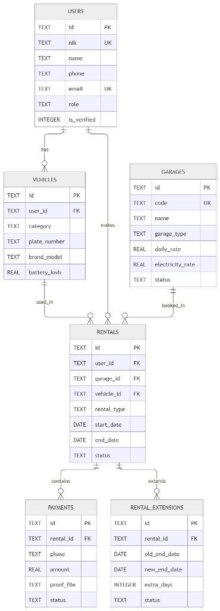  
*Gambar 3. Entity-Relationship Diagram (ERD) Basis Data Relasional*

### 4.1 Rincian Entitas dan Skema Tabel:
1. **`USERS`:** Menyimpan data identitas kredensial pengguna (`id` PK, `nik` UK 16 digit, `name`, `phone`, `email` UK, `role`, `is_verified`).
2. **`VEHICLES`:** Menyimpan master data kendaraan milik pelanggan (`id` PK, `user_id` FK, `category`, `plate_number`, `brand_model`, `battery_kwh`).
3. **`GARAGES`:** Menyimpan master data unit fisik slot garasi (`id` PK, `code` UK, `name`, `garage_type`, `daily_rate`, `electricity_rate`, `status`).
4. **`RENTALS`:** Mencatat kontrak transaksi penyewaan garasi (`id` PK, `user_id` FK, `garage_id` FK, `vehicle_id` FK, `rental_type`, `start_date`, `end_date`, `status`).
5. **`PAYMENTS`:** Menyimpan data pembayaran dan struk transfer (`id` PK, `rental_id` FK, `phase`, `amount`, `proof_file`, `status`).
6. **`RENTAL_EXTENSIONS`:** Merekam jejak riwayat perpanjangan sewa aktif (`id` PK, `rental_id` FK, `old_end_date`, `new_end_date`, `extra_days`, `status`).

### 4.2 Matriks Relasi dan Kardinalitas Antar Tabel:
| Hubungan Relasi Antar Tabel | Kardinalitas | Integritas Foreign Key & Penjelasan Bisnis |
|---|:---:|---|
| **USERS ➔ VEHICLES** | **1 : N** | Satu pengguna dapat mendaftarkan banyak kendaraan miliknya ke dalam akun (`ON DELETE CASCADE`). |
| **USERS ➔ RENTALS** | **1 : N** | Satu penyewa terverifikasi dapat memiliki banyak riwayat transaksi sewa sepanjang waktu. |
| **GARAGES ➔ RENTALS** | **1 : N** | Satu unit fisik garasi dapat disewa berulang kali pada jadwal/tanggal berbeda (`ON DELETE RESTRICT`). |
| **VEHICLES ➔ RENTALS** | **1 : N** | Satu kendaraan dapat tercatat pada beberapa transaksi penyewaan garasi. |
| **RENTALS ➔ PAYMENTS** | **1 : N** | Satu transaksi sewa dapat memiliki catatan pembayaran sewa awal maupun perpanjangan (`ON DELETE CASCADE`). |
| **RENTALS ➔ RENTAL_EXTENSIONS** | **1 : N** | Satu transaksi sewa aktif dapat diperpanjang beberapa kali selama masa sewa berjalan (`ON DELETE CASCADE`). |

---

## 5. Penjelasan Library / Pre-Existing Component yang Digunakan

Dalam pemenuhan unit kompetensi **J.620100.019.02 (Menggunakan Library atau Komponen Pre-Existing)**, aplikasi memanfaatkan komponen pre-existing modern:

| Library / Tools | Versi | Lisensi | Fungsi dan Alasan Pemilihan Teknis |
|---|:---:|:---:|---|
| **SvelteKit & Svelte Core** | `^3.2.0` / `^5.57.3` | MIT | Framework full-stack modern dengan arsitektur reaktif Svelte 5 Runes tanpa Virtual DOM overhead. Menangani perutean berbasis file (`+page.svelte`), aksi form server-side (`+page.server.ts`), dan SSR dalam satu kesatuan kode yang sangat cepat. |
| **TypeScript & Bun** | `^6.0.3` / `1.4.0` | Apache-2.0 / MIT | TypeScript memastikan keamanan tipe data (*type-safety*) statis untuk mencegah runtime error pada model OOP dan query SQL, sedangkan Bun dipakai sebagai runtime super cepat dan package manager efisien. |
| **Tailwind CSS v4** | `^4.3.5` | MIT | Framework CSS utilitas generasi terbaru berbasis engine kompilasi instan. Memudahkan pembuatan antarmuka modern responsif dengan palet warna natural hangat (*Warm Olive*, *Slate*, *Khaki Linen*). |
| **node:sqlite (ACID)** | Built-in Node 22 | Public Domain | Engine basis data relasional bawaan resmi Node.js (`DatabaseSync`) yang mendukung penuh transaksi ACID, Foreign Key Constraints, dan performa query baca/tulis lokal sangat tinggi tanpa dependensi eksternal. |
| **Lucide Icons** | `^1.77.0` | ISC | Koleksi ikon vektor SVG elegan dan konsisten untuk navigasi visual status garasi, ikon kendaraan, charging hub SPKLU, serta indikator verifikasi akun. |
| **Vitest Runner** | `^5.1.0` | MIT | Test runner modern berbasis Vite engine untuk menjalankan pengujian unit otomatis pada seluruh domain model, validasi batas nilai BVA, dan rumus kalkulasi biaya sewa. |

---

## 6. Fitur-Fitur Aplikasi yang Dihasilkan

### 6.1 Halaman Utama (Landing Page & Simulasi Biaya Interaktif GARTA)
Halaman beranda menyajikan informasi profil operasional penitipan kendaraan di Takalar, visualisasi langsung status ketersediaan slot garasi secara real-time, kalkulator interaktif simulasi tarif sewa, kartu fitur unggulan (Proteksi CCTV 24/7, Kanopi Anti Karat, SPKLU Wallbox 22 kW, Lokasi Strategis), serta tombol cepat menuju formulir login dan pendaftaran akun.

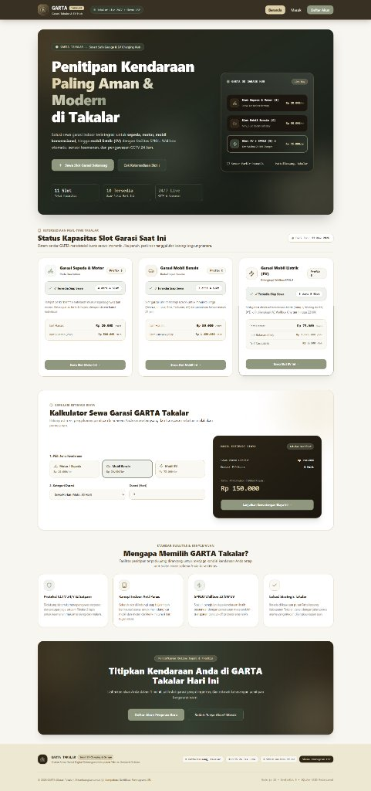  
*Gambar 4. Halaman Utama (Landing Page & Simulasi Biaya Interaktif GARTA)*

---

### 6.2 Halaman Autentikasi dan Masuk ke Portal GARTA
Halaman login menyediakan form autentikasi berbasis sesi yang memvalidasi alamat email dan kata sandi pengguna secara aman. Sistem secara otomatis mendeteksi peran pengguna (*Role-Based Access Control*) untuk mengarahkan Administrator ke Panel Manajemen Operasional dan Penyewa ke Dashboard Sewa Pelanggan.

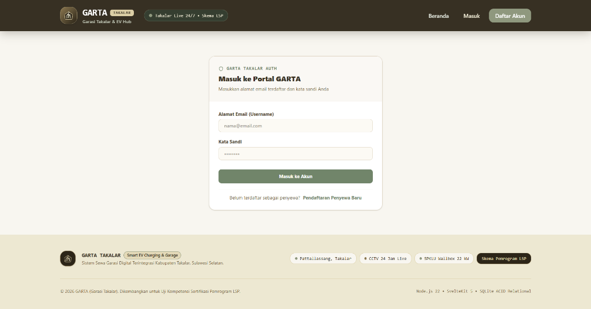  
*Gambar 5. Halaman Autentikasi dan Masuk ke Portal GARTA*

---

### 6.3 Formulir Pendaftaran Calon Penyewa dengan Validasi NIK 16 Digit
Formulir registrasi calon penyewa menerapkan validasi ketat di sisi klien dan server: Nomor Induk Kependudukan (NIK KTP) wajib tepat 16 digit angka numerik, nama lengkap sesuai identitas resmi KTP, nomor telepon/WhatsApp 10–15 digit, format email unik, dan kata sandi minimal 6 karakter. Akun baru yang berhasil mendaftar otomatis memiliki status awal PENDING.

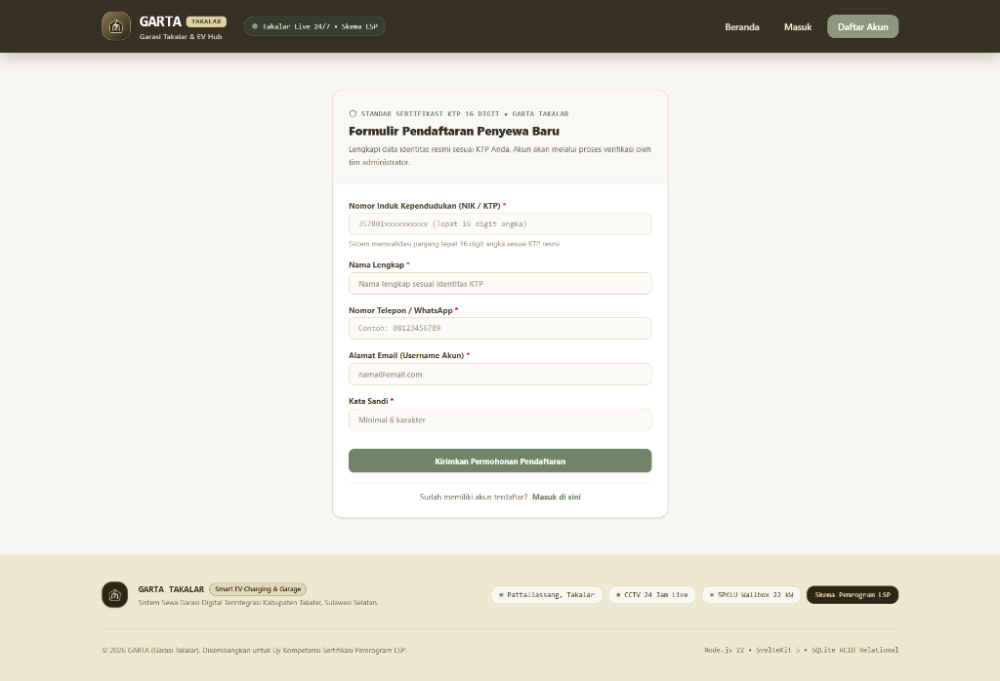  
*Gambar 6. Formulir Pendaftaran Calon Penyewa dengan Validasi NIK 16 Digit*

---

### 6.4 Halaman Otorisasi & Verifikasi Validasi KTP Calon Penyewa pada Panel Admin
Administrator memiliki menu khusus Verifikasi KTP untuk memeriksa keabsahan pendaftar baru. Administrator dapat memeriksa nomor NIK 16 digit, nama lengkap, kontak, serta tanggal registrasi. Admin dapat menyetujui akun menjadi DISETUJUI (APPROVED) sehingga penyewa dapat langsung memesan garasi, atau menolak akun menjadi DITOLAK (REJECTED) jika identitas tidak valid.

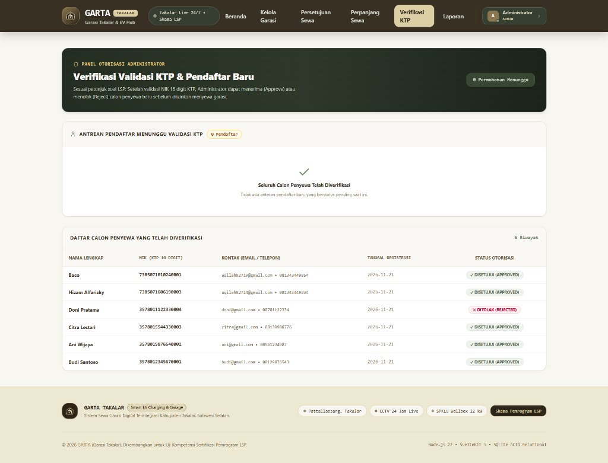  
*Gambar 7. Halaman Otorisasi & Verifikasi Validasi KTP Calon Penyewa pada Panel Admin*

---

### 6.5 Formulir Pemesanan Sewa Slot Garasi Baru
Penyewa terverifikasi (APPROVED) dapat melakukan pemesanan sewa garasi baru melalui formulir 3 langkah terpadu:
1. Memilih kategori kendaraan (Sepeda Motor, Mobil Bensin, Mobil Listrik EV, Sepeda Gowes), mengisi merek serta nomor plat kendaraan.
2. Memilih skema durasi: Harian (maksimal 30 hari) atau Bulanan (hemat 25x tarif harian) dengan tanggal mulai hari ini.
3. Memilih unit slot garasi kosong yang tersedia. Sistem langsung menampilkan rincian total pembayaran dan kotak unggah gambar struk transfer pelunasan biaya.

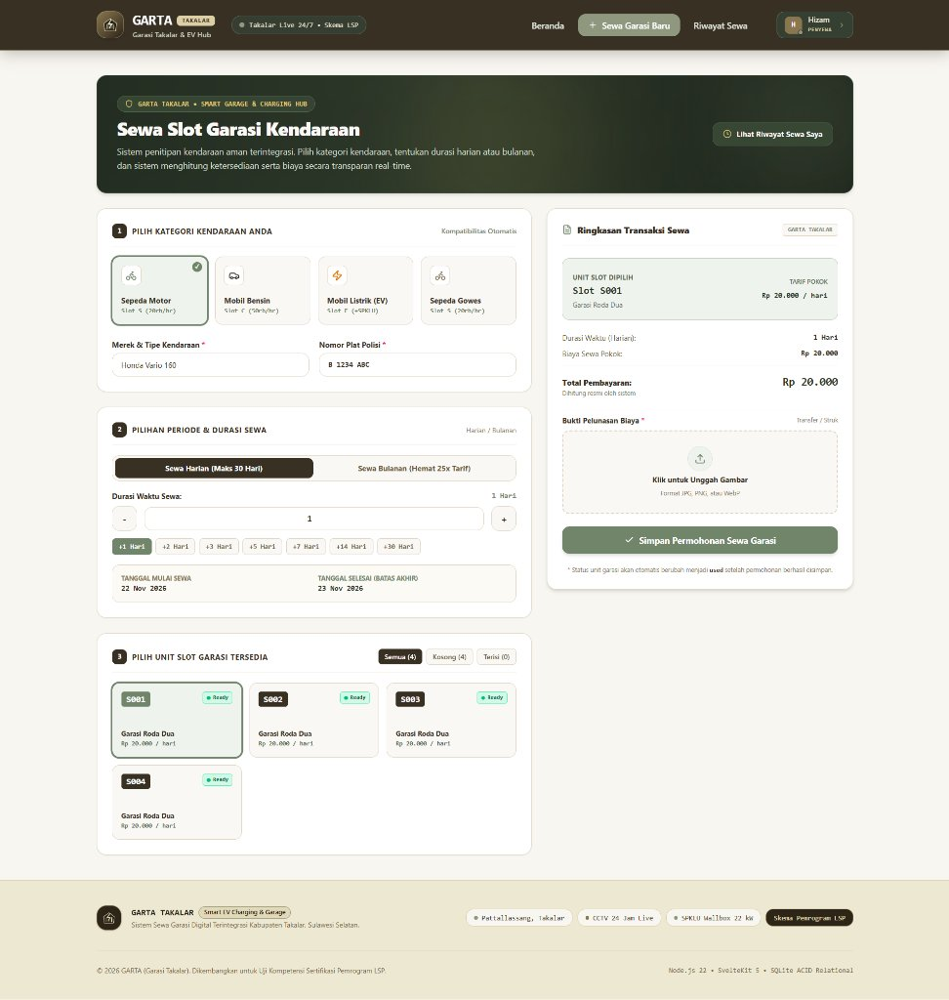  
*Gambar 8. Formulir Sewa Slot Garasi Baru (Kategori Kendaraan, Durasi, Pilihan Slot, & Bukti Bayar)*

---

### 6.6 Panel Persetujuan & Verifikasi Transaksi Sewa (ACC Permohonan) oleh Admin
Administrator mengakses panel Persetujuan Sewa untuk memverifikasi permohonan booking baru dan permohonan perpanjangan dari pelanggan. Admin memeriksa foto struk transfer pembayaran yang diunggah pelanggan, lalu melakukan aksi persetujuan (ACC) atau tolak. Begitu di-ACC, status sewa aktif dan slot fisik garasi terkunci menjadi Sedang Terparkir.

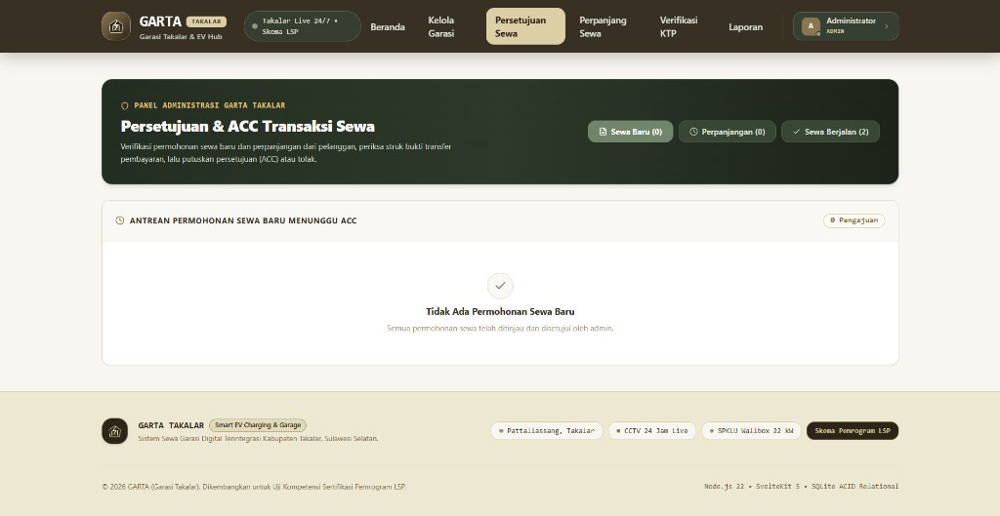  
*Gambar 9. Panel Persetujuan & Verifikasi Transaksi Sewa (ACC Permohonan) oleh Admin*

---

### 6.7 Panel Inventaris Unit Garasi dan Pengaturan Kapasitas Massal (Batch Creation)
Halaman Kelola Slot Garasi menyajikan ringkasan indikator kapasitas (Total Kapasitas 11 Slot, 10 Siap Sewa, 1 Sedang Terparkir, sebaran kategori 4 S, 4 C, 3 E) serta grid visual slot parkir interaktif. Administrator dapat menambahkan unit garasi secara berkelompok (massal/batch) hingga 999 unit per kategori dengan penomoran otomatis bertahap (`S001`, `C001`, `E001`) serta mengubah tarif sewa harian dan tarif listrik sewaktu-waktu.

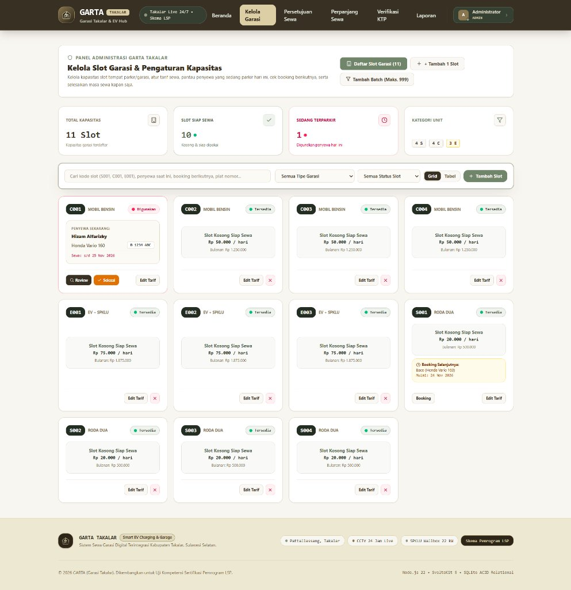  
*Gambar 10. Panel Inventaris Unit Garasi dan Pengaturan Kapasitas Massal (Batch Creation)*

---

### 6.8 Panel Perpanjangan Masa Sewa Garasi Aktif Hari Ini & Riwayat Perpanjangan
Menu Perpanjang Sewa menampilkan daftar unit garasi yang sedang aktif disewa pada tanggal sistem hari berjalan (misalnya unit `C001` atas nama Hizam Alfarizky). Administrator dapat memperpanjang masa sewa dengan memilih tanggal batas baru; sistem secara instan menghitung selisih tambahan hari dan sisa biaya yang harus dibayar. Admin mengunggah bukti pelunasan perpanjangan dan menyimpannya ke dalam sistem.

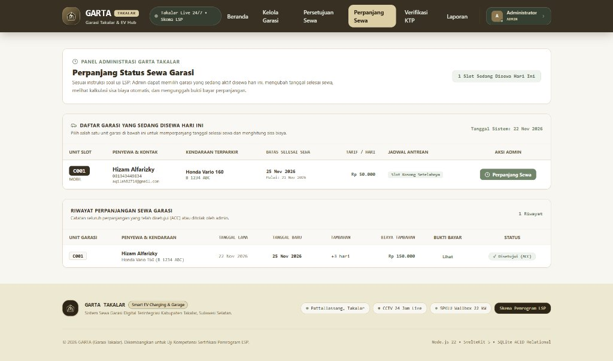  
*Gambar 11. Panel Perpanjangan Masa Sewa Garasi Aktif Hari Ini & Riwayat Perpanjangan*

---

### 6.9 Panel Riwayat & Kontrak Sewa Garasi pada Sisi Penyewa (Customer Dashboard)
Pelanggan dapat memantau seluruh kontrak sewa melalui dashboard akun pribadi. Panel menampilkan jumlah kontrak total, status unit sedang aktif terparkir (misalnya `C001` - Honda Vario 160), riwayat penyesuaian perpanjangan (+3 hari sebesar Rp150.000 Disetujui ACC), serta riwayat sewa yang telah selesai digunakan (unit `S001`).

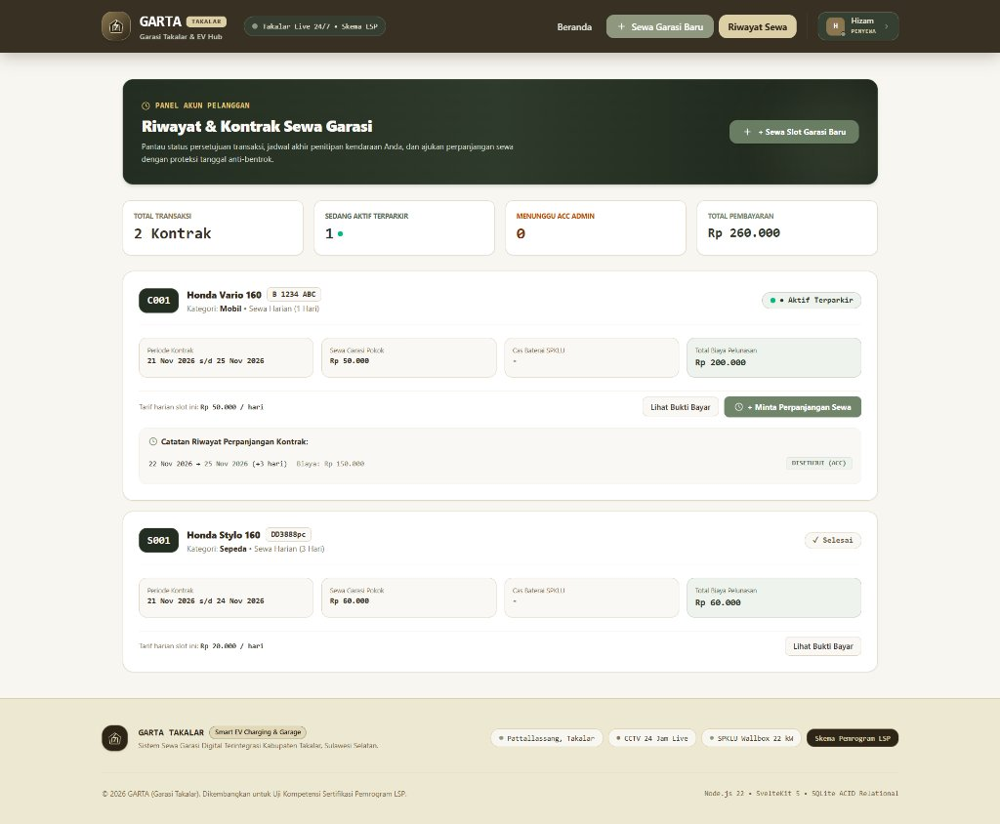  
*Gambar 12. Panel Riwayat & Kontrak Sewa Garasi pada Sisi Penyewa (Customer Dashboard)*

---

### 6.10 Halaman Profil Pengguna, Verifikasi Status NIK KTP, dan Logout Aman
Sebelum mengakhiri sesi, pengguna dapat membuka halaman profil `/profile` untuk memeriksa identitas akun terdaftar: Nomor Induk Kependudukan (NIK KTP 16 digit: `7305071606190003`), nama lengkap, email, nomor telepon, status otorisasi APPROVED, jumlah transaksi aktif, dan tombol keluar (Keluar / Logout) aman dari sistem.

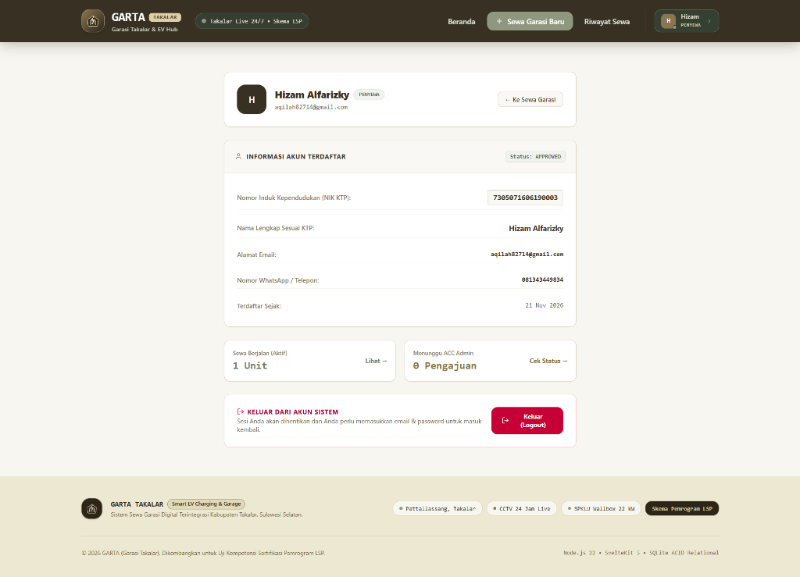  
*Gambar 13. Halaman Profil Pengguna, Verifikasi Status NIK KTP, dan Logout Aman*

---

### 6.11 Halaman Laporan Persewaan dan Rekapitulasi Keuangan Admin dengan Fitur Cetak PDF
Panel Administrasi Finansial menyajikan ringkasan total transaksi, pendapatan sewa pokok, pemasukan cas baterai SPKLU, dan akumulasi omset total. Laporan menyediakan 4 tab mode filter fleksibel: (1) Per Bulan dalam Tahun Tertentu, (2) Per Hari dalam Bulan Tertentu, (3) Per Tipe Garasi, dan (4) Per Penyewa. Laporan dilengkapi tombol Cetak / Ekspor PDF untuk menghasilkan dokumen laporan cetak resmi secara otomatis.

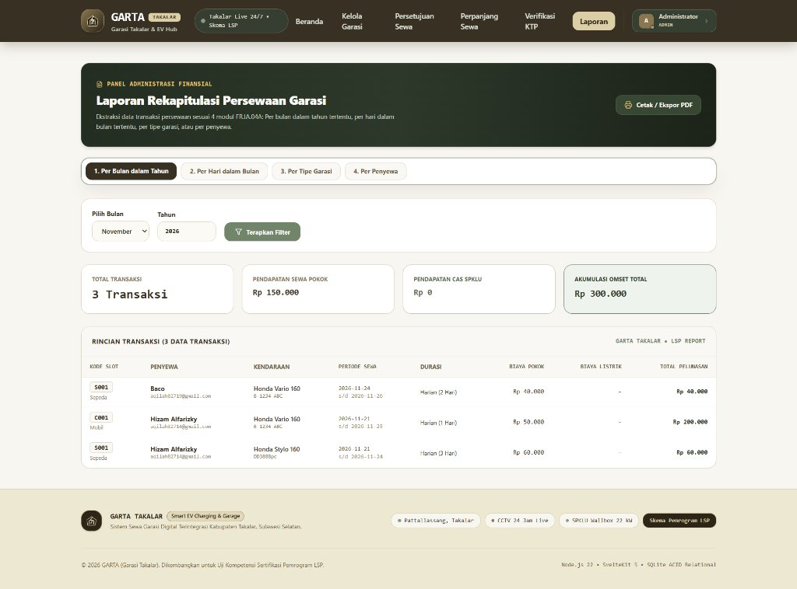  
*Gambar 14. Halaman Laporan Persewaan dan Rekapitulasi Keuangan Admin dengan Fitur Cetak PDF*

---

## 7. Skenario dan Hasil Pengujian Unit Testing (J.62010.033.02)

Pengujian unit pada aplikasi GARASI TA dijalankan secara otomatis menggunakan test runner **Vitest** dengan pendekatan *Black-box Testing*. Teknik pengujian mencakup:
- **Boundary Value Analysis (BVA):** Menguji nilai batas ekstrem sistem, seperti penomoran kode urut unit 1 hingga 999, batas durasi sewa harian 1 hingga 30 hari, dan batas minimal validasi tanggal.
- **Equivalence Partitioning (EP):** Menguji partisi kelas input valid dan tidak valid pada matriks kecocokan jenis kendaraan terhadap tipe garasi, skema sewa bulanan flat 25x, serta formula cas listrik EV.

### Tabel Rincian 14 Skenario Pengujian Unit (Vitest):

| No | Modul / Komponen Uji | Teknik | Skenario dan Data Uji | Hasil yang Diharapkan | Status |
|:---:|---|:---:|---|---|:---:|
| 1 | `GarageCodeGenerator` | BVA | Pembuatan kode garasi dengan nomor urut 1, 10, dan 99 pada prefix S, C, dan E. | Menghasilkan kode 3 digit: `S001`, `C010`, `E099`. | **PASS** |
| 2 | `GarageCodeGenerator` | EP | Pembuatan kode berurutan massal (batch) sebanyak 3 unit garasi listrik (start urutan 1). | Menghasilkan array kode: `["E001", "E002", "E003"]`. | **PASS** |
| 3 | `GarageCodeGenerator` | BVA | Input nomor urut garasi tidak valid: nomor 0 dan nomor 1000 (melebihi kuota 999). | Sistem melempar exception error batas kapasitas 1–999. | **PASS** |
| 4 | Matriks Kompatibilitas | EP | Uji kecocokan sepeda manual dan sepeda motor terhadap tipe garasi sepeda, mobil, dan listrik. | Hanya diterima pada garasi sepeda (`true`); ditolak pada mobil dan listrik (`false`). | **PASS** |
| 5 | Matriks Kompatibilitas | EP | Uji kecocokan mobil bensin/diesel terhadap garasi sepeda, mobil, dan mobil listrik. | Hanya diterima pada garasi mobil (`true`); ditolak pada garasi sepeda dan listrik (`false`). | **PASS** |
| 6 | Matriks Kompatibilitas | EP | Uji kecocokan mobil listrik (EV) terhadap garasi sepeda, mobil, dan mobil listrik. | Diterima pada garasi mobil dan mobil_listrik (`true`); ditolak pada sepeda (`false`). | **PASS** |
| 7 | Kalkulator Tarif Sewa | BVA | Perhitungan sewa harian sepeda tarif Rp10.000/hari durasi 5 hari mulai 21 Nov 2026. | Biaya sewa tepat Rp50.000, biaya listrik Rp0, total Rp50.000, selesai 26 Nov 2026. | **PASS** |
| 8 | Kalkulator Tarif Sewa | BVA | Validasi batas sewa harian maksimal dengan memasukkan durasi 31 hari pada paket harian. | Sistem menolak dan melempar error batas sewa harian maksimal 30 hari. | **PASS** |
| 9 | Kalkulator Tarif Sewa | EP | Perhitungan sewa bulanan mobil bensin tarif harian Rp50.000 durasi 2 bulan sewa. | Tarif bulanan flat: $25 \times 50.000 = 1.250.000$; total 2 bulan tepat Rp2.500.000. | **PASS** |
| 10 | Kewajiban Listrik EV | EP | Sewa garasi EV (tarif listrik Rp2.000/kWh) untuk mobil listrik baterai 60 kWh selama 3 hari. | Sewa pokok $3 \times 75.000 = 225.000$; cas listrik $60 \times 2.000 = 120.000$; total Rp345.000. | **PASS** |
| 11 | Mobil EV di Garasi Biasa | EP | Mobil listrik menyewa garasi mobil konvensional tanpa fasilitas stasiun SPKLU Wallbox. | Biaya cas listrik terhitung tepat Rp0 (tanpa fasilitas pengisian daya). | **PASS** |
| 12 | Perpanjangan Sewa | BVA | Perpanjangan kontrak dari 26 Nov 2026 menjadi 01 Des 2026 (selisih 5 hari) tarif Rp50.000. | Tambahan hari 5 hari; biaya perpanjangan dihitung tepat $5 \times 50.000 = \text{Rp}250.000$. | **PASS** |
| 13 | Validasi Tanggal Perpanjang | BVA | Mengubah tanggal selesai perpanjangan baru lebih awal atau sama dengan tanggal selesai lama. | Sistem menolak dengan pesan error tanggal perpanjangan tidak valid. | **PASS** |
| 14 | Service Formatting Salam | EP | Pengujian fungsi greeting service komponen penyapa pengguna sistem. | Menghasilkan string sapaan terformat valid sesuai parameter input. | **PASS** |

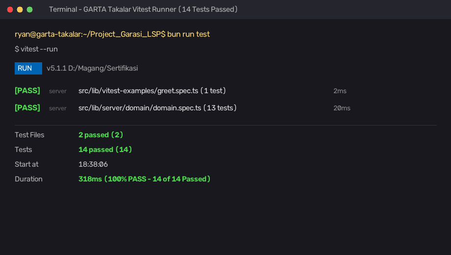  
*Gambar 15. Hasil Pengujian Unit Testing Menggunakan Vitest (14 dari 14 Skenario Berhasil Lulus 100%)*

Dari hasil eksekusi Vitest runner pada terminal (Gambar 15), 2 berkas pengujian dengan total 14 skenario pengujian unit berhasil lulus seluruhnya (14/14 passed) dalam waktu eksekusi singkat 318 ms. Hasil ini membuktikan bahwa seluruh aturan bisnis spesifikasi program, validasi batas nilai BVA, integritas logika OOP, formula sewa bulanan flat 25x, dan algoritma finansial telah terverifikasi secara matematis dan fungsional.

---

## 8. Tautan Repositori GitHub & Panduan Menjalankan Sistem

Seluruh kode sumber aplikasi GARASI TA dikelola menggunakan sistem kontrol versi Git dan dapat diakses publik melalui tautan repositori GitHub resmi berikut:  
**URL Repositori GitHub:**  
👉 **[https://github.com/mzkyann/Project_Garasi_LSP_Muh_Ryan_Ardiansyah](https://github.com/mzkyann/Project_Garasi_LSP_Muh_Ryan_Ardiansyah)**

### 8.1 Panduan Menjalankan Aplikasi di Lingkungan Lokal:
1. **Prasyarat Lingkungan:**
   - Bun runtime versi 1.4.0+ (atau Node.js versi 20+).
   - Git CLI.
2. **Kloning Repositori:**
   ```bash
   git clone https://github.com/mzkyann/Project_Garasi_LSP_Muh_Ryan_Ardiansyah.git
   cd Project_Garasi_LSP_Muh_Ryan_Ardiansyah
   ```
3. **Instalasi Dependensi:**
   ```bash
   bun install
   # atau
   npm install
   ```
4. **Eksekusi Unit Testing (Vitest):**
   ```bash
   bun run test
   # atau
   npm run test
   ```
5. **Menjalankan Server Lokal (Dev Server):**
   ```bash
   bun run dev
   # atau
   npm run dev
   ```
   Buka peramban pada alamat lokal: `http://localhost:5173`.
6. **Reset Basis Data (Opsional):**
   ```bash
   bun run db:reset
   ```

### 8.2 Daftar Akun Demo Pengujian untuk Asesor LSP:
| Peran Pengguna | Email Login (Username) | Kata Sandi | NIK KTP 16 Digit | Status Akun | Skenario Demonstrasi Uji Kompetensi |
|---|---|---|---|:---:|---|
| **Administrator** | `admin@garasi.id` | `admin123` | `1234567890123456` | `APPROVED` | Batch create garasi, verifikasi KTP, ACC sewa, perpanjang sewa hari ini, cetak PDF. |
| **Penyewa (Aktif 1)** | `aqilah82714@gmail.com` | `penyewa123` | `7305071606190003` | `APPROVED` | Akun Hizam Alfarizky, kontrak aktif C001 (+3 hari perpanjangan) & riwayat S001. |
| **Penyewa (Aktif 2)** | `budi@gmail.com` | `budi123` | `3578012345670001` | `APPROVED` | Penyewa terverifikasi untuk uji pemesanan slot sewa baru harian/bulanan & kWh listrik EV. |
| **Penyewa (Pending 1)** | `ani@gmail.com` | `ani123` | `3578019876540002` | `PENDING` | Uji proteksi dashboard saat akun belum diverifikasi admin. |
| **Penyewa (Pending 2)** | `citra@gmail.com` | `citra123` | `3578015544330003` | `PENDING` | Antrean verifikasi calon penyewa untuk demonstrasi aksi Approve/Reject admin. |
| **Penyewa (Ditolak)** | `doni@gmail.com` | `doni123` | `3578011122330004` | `REJECTED` | Demonstrasi status penolakan pendaftaran calon penyewa. |

---
*Demikian Laporan Proyek Sistem Manajemen dan Penyewaan Garasi (GARASI TA) ini disusun dengan sebenar-benarnya sebagai bukti unjuk kerja portofolio asesi pada Uji Kompetensi Keahlian Skema Okupasi Pemrogram.*
