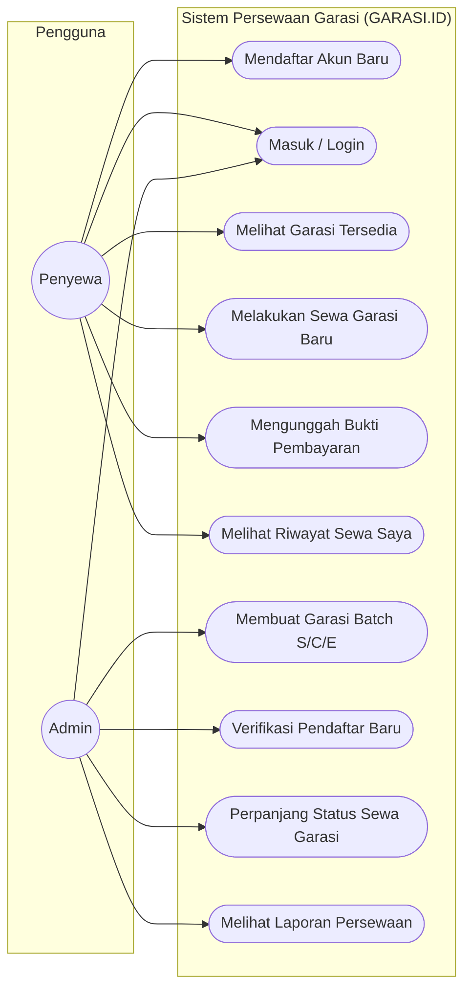
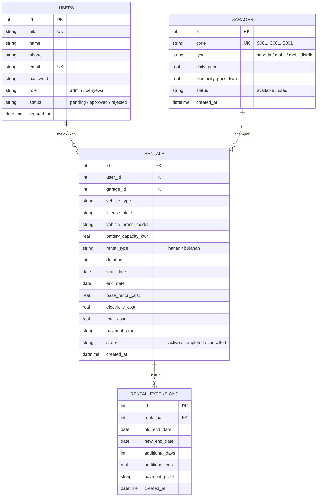

# LAPORAN PROYEK UJI KOMPETENSI SKEMA SERTIFIKASI PEMROGRAM
**Nomor Skema:** IMT.01.15/SSK/LSP/IX/2021  
**Nama Asesor:** Citra Lestari  
**Tanggal Uji:** 21 November 2026  
**Judul Proyek:** Sistem Aplikasi Persewaan Garasi Kendaraan (GARASI.ID)

---

## 1. Ringkasan Eksekutif & Pemenuhan Unit Kompetensi
Proyek ini dibangun untuk memenuhi seluruh unit kompetensi dalam skema sertifikasi Pemrogram:
1. **J.620100.009.02 (Menggunakan Spesifikasi Program):** Menerjemahkan kebutuhan bisnis persewaan garasi kendaraan harian/bulanan, batasan tipe kendaraan terhadap garasi, pengisian daya baterai mobil listrik (100% full charge), dan perpanjangan sewa.
2. **J.620100.016.01 (Menulis Kode dengan Prinsip Guidelines & Best Practices):** Menerapkan Clean Code, pemisahan Domain Logic, Persistence Layer, dan UI Presentation Layer.
3. **J.620100.017.02 (Pemrograman Terstruktur):** Alur logika modular terstruktur pada kalkulasi biaya, filter relasional, dan transaksi sewa.
4. **J.620100.018.02 (Pemrograman Berorientasi Objek / OOP):** Mengimplementasikan abstraksi, pewarisan (*inheritance*), dan polimorfisme pada kelas `Vehicle` (`Bicycle`, `Motorcycle`, `GasolineCar`, `ElectricCar`) dan kelas `Garage` (`BicycleGarage`, `CarGarage`, `ElectricCarGarage`).
5. **J.620100.019.02 (Menggunakan Library / Komponen Pre-existing):** Memanfaatkan framework SvelteKit 5, TypeScript, Tailwind CSS v4, Lucide Icons, dan Vitest.
6. **J.620100.021.02 (Menerapkan Akses Basis Data Relasional):** Mengimplementasikan basis data relasional SQLite (`node:sqlite`) dengan dukungan *Foreign Keys*, integritas referensial, dan transaksi ACID.
7. **J.620100.025.02 (Melakukan Debugging):** Pengujian menyeluruh pada level server-side, validasi form, dan *handling* error secara graceful.
8. **J.62010.033.02 (Melaksanakan Pengujian Unit Program):** 14 skenario unit testing otomatis menggunakan Vitest yang menguji kompatibilitas parkir, formula harga harian/bulanan, biaya listrik, dan perpanjangan sewa.

---

## 2. Use-Case Diagram



---

## 3. Class Diagram (Penerapan OOP & Best Practices)

```mermaid
classDiagram
    class Vehicle {
        <<abstract>>
        #string _brandAndType
        #string _category
        #string _licensePlate
        +category: string
        +brandAndType: string
        +licensePlate: string
        +validateLicensePlate() bool
    }

    class Bicycle {
        +Bicycle(brandAndType)
    }

    class Motorcycle {
        +Motorcycle(brandAndType, licensePlate)
    }

    class GasolineCar {
        +GasolineCar(brandAndType, licensePlate)
    }

    class ElectricCar {
        -number _batteryCapacityKwh
        +batteryCapacityKwh: number
        +ElectricCar(brandAndType, licensePlate, batteryCapacityKwh)
    }

    Vehicle <|-- Bicycle
    Vehicle <|-- Motorcycle
    Vehicle <|-- GasolineCar
    Vehicle <|-- ElectricCar

    class Garage {
        <<abstract>>
        #number id
        #string _code
        #string _type
        #number _dailyPrice
        #string _status
        +monthlyPrice: number
        +status: string
    }

    class BicycleGarage {
        +BicycleGarage(code, dailyPrice)
    }

    class CarGarage {
        +CarGarage(code, dailyPrice)
    }

    class ElectricCarGarage {
        -number _electricityPricePerKwh
        +electricityPricePerKwh: number
        +ElectricCarGarage(code, dailyPrice, electricityPricePerKwh)
    }

    Garage <|-- BicycleGarage
    Garage <|-- CarGarage
    Garage <|-- ElectricCarGarage

    class RentalCalculator {
        +isCompatible(vehicleCategory, garageType) bool
        +calculateEndDate(startDate, rentalType, duration) string
        +calculateNewRentalCost(vehicle, garage, rentalType, duration, startDate) RentalCostBreakdown
        +calculateExtensionCost(oldEndDate, newEndDate, dailyPrice) ExtensionCostBreakdown
    }

    class GarageCodeGenerator {
        +getPrefix(type) string
        +formatCode(type, sequenceNumber) string
        +generateBatchCodes(type, startingSeq, count) string[]
    }
```



---

## 4. Entity-Relationship Diagram (ERD Basis Data Relasional)



---

## 5. Penjelasan Library & Komponen Pre-existing (J.620100.019.02)
1. **SvelteKit 5 (Full-stack Framework):** Framework modern berbasis kompilasi reaktif (*runes*), menyediakan server-side rendering (SSR), perutean berbasis direktori (`+page.server.ts`), dan penanganan aksi formulir (*form actions*).
2. **TypeScript:** Memastikan *type safety* pada entitas model domain dan mencegah *runtime error*.
3. **node:sqlite (DatabaseSync):** Engine basis data relasional SQLite bawaan Node.js yang memproses query SQL, integritas relasional relasional foreign keys, dan transaksi secara cepat tanpa dependensi eksternal binary.
4. **Tailwind CSS v4:** Framework CSS utilitas untuk mendesain antarmuka pengguna responsif, bersih, dan modern.
5. **Vitest:** Test runner berkecepatan tinggi berbasis Vite untuk menjalankan pengujian unit program (*Unit Testing*).

---

## 6. Fitur-Fitur Aplikasi yang Dihasilkan
1. **Autentikasi & Otorisasi Berbasis Role:**
   - Role Admin dan Role Penyewa.
   - Pendaftaran Penyewa baru dengan validasi NIK 16 digit, Nama, No. Telepon, Email, dan Password. Status awal `pending`.
   - Tombol *Quick Login Demo* untuk memudahkan presentasi penguji/asesor.
2. **Verifikasi Pendaftar Baru (Admin):**
   - Menampilkan antrean pendaftar berstatus `pending`.
   - Fitur validasi KTP: Admin dapat menyetujui (*Approve*) atau menolak (*Reject*).
3. **Manajemen Garasi Berkelompok (Batch Creation - Admin):**
   - Pembuatan garasi secara massal (1 - 999 unit).
   - Penomoran otomatis bertahap:
     - `S001`, `S002`, ... untuk Garasi Sepeda.
     - `C001`, `C002`, ... untuk Garasi Mobil.
     - `E001`, `E002`, ... untuk Garasi Mobil Listrik.
   - Input harga sewa harian (harga bulanan otomatis = 25 x harian) dan tarif listrik per kWh untuk garasi mobil listrik.
4. **Sewa Baru Garasi (Penyewa):**
   - Pilihan kendaraan: Sepeda, Motor, Mobil Bensin, Mobil Listrik.
   - Validasi plat nomor (wajib kecuali sepeda).
   - Input kapasitas baterai (kWh) khusus mobil listrik.
   - Penyaringan otomatis tipe garasi yang kompatibel (Sepeda/Motor $\rightarrow$ Sepeda; Mobil $\rightarrow$ Mobil; Mobil Listrik $\rightarrow$ Mobil atau Listrik).
   - Menampilkan daftar garasi yang berstatus `available` pada hari ini.
   - Perhitungan total biaya otomatis secara real-time:
     - Biaya pokok (Harian maks 30 hari atau Bulanan).
     - Biaya pengisian penuh baterai (Kapasitas kWh $\times$ tarif per kWh) jika mobil listrik di garasi listrik.
   - Unggah bukti pembayaran pelunasan.
   - Status garasi otomatis berubah menjadi `used`.
5. **Perpanjang Status Sewa Garasi (Admin):**
   - Menampilkan garasi yang sedang aktif disewa hari ini.
   - Admin memilih garasi dan mengubah tanggal selesai sewa baru.
   - Sistem menghitung otomatis selisih hari dan biaya perpanjangan secara presisi.
   - Admin mengunggah bukti bayar perpanjangan.
6. **Laporan Persewaan Garasi (Admin):**
   - Rekapitulasi per bulan dalam tahun tertentu.
   - Rekapitulasi per hari dalam bulan tertentu.
   - Rekapitulasi per tipe garasi.
   - Rekapitulasi per penyewa.
   - Ringkasan total transaksi, omset sewa pokok, omset listrik, dan grand total dengan tombol Cetak / Simpan PDF.

---

## 7. Skenario Unit Testing (J.62010.033.02)
Pengujian dijalankan dengan perintah `npm run test` (Vitest):

| No | Modul / Skenario Uji | Ekspektasi | Hasil |
|---|---|---|:---:|
| 1 | `GarageCodeGenerator.formatCode` | Menghasilkan kode berformat `S001`, `C010`, `E099` | **PASSED** |
| 2 | `GarageCodeGenerator.generateBatchCodes` | Menghasilkan array kode berurutan `['E001', 'E002', 'E003']` | **PASSED** |
| 3 | `GarageCodeGenerator` batas nomor urut | Menolak nomor urut $< 1$ atau $> 999$ | **PASSED** |
| 4 | Kompatibilitas Sepeda & Sepeda Motor | Hanya diizinkan di garasi tipe `sepeda` | **PASSED** |
| 5 | Kompatibilitas Mobil Konvensional | Hanya diizinkan di garasi tipe `mobil` | **PASSED** |
| 6 | Kompatibilitas Mobil Listrik | Diizinkan di garasi `mobil` maupun `mobil_listrik` | **PASSED** |
| 7 | Perhitungan Sewa Harian Sepeda | $5 \text{ hari} \times \text{Rp } 10.000 = \text{Rp } 50.000$ | **PASSED** |
| 8 | Validasi Maksimal Sewa Harian | Melebihi 30 hari menghasilkan error validasi | **PASSED** |
| 9 | Perhitungan Sewa Bulanan ($25 \times \text{harian}$) | $2 \text{ bulan} \times (25 \times \text{Rp } 50.000) = \text{Rp } 2.500.000$ | **PASSED** |
| 10 | Kewajiban Isi Listrik Penuh Mobil Listrik | Biaya sewa + ($60 \text{ kWh} \times \text{Rp } 2.000 = \text{Rp } 120.000$) | **PASSED** |
| 11 | Mobil Listrik di Garasi Mobil Biasa | Biaya listrik adalah Rp 0 (tidak ada fasilitas charging) | **PASSED** |
| 12 | Perhitungan Biaya Perpanjangan Sewa | Selisih 5 hari $\times \text{Rp } 50.000 = \text{Rp } 250.000$ | **PASSED** |
| 13 | Validasi Tanggal Perpanjangan | Tanggal baru $\le$ tanggal lama melempar error | **PASSED** |
| 14 | Sample Service Component Greeting | Format greeting valid | **PASSED** |

**Status Pengujian:** 14 dari 14 uji coba berhasil lulus (100% Passed).

---

## 8. Panduan Menjalankan Aplikasi
1. **Prasyarat:** Node.js versi 20+ (Direkomendasikan Node.js 22/24).
2. **Instalasi Dependensi:**
   ```bash
   npm install
   ```
3. **Menjalankan Unit Test:**
   ```bash
   npm run test
   ```
4. **Menjalankan Server Pengembangan (Dev Server):**
   ```bash
   npm run dev
   ```
   Buka peramban pada alamat `http://localhost:5173`.
5. **Akun Pengujian Demo yang Telah Tersedia:**
   - **Admin:** `admin@garasi.id` | Password: `admin123`
   - **Penyewa (Aktif):** `budi@gmail.com` | Password: `budi123`
   - **Penyewa (Pending):** `ani@gmail.com` | Password: `ani123`
